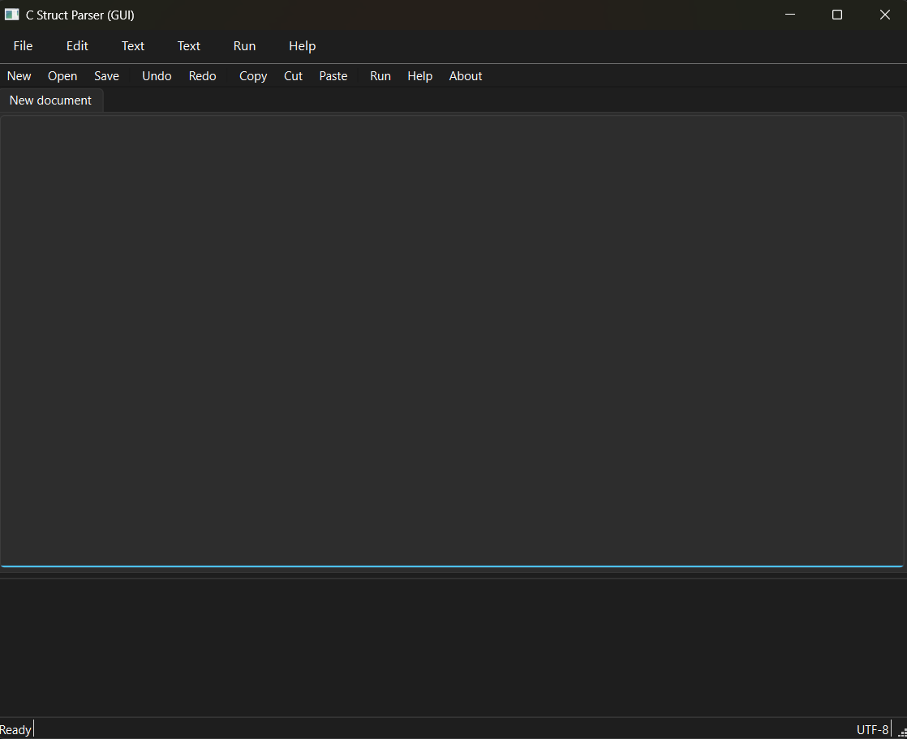

# C Struct Parser (GUI)

A graphical user interface module for a C struct declaration parser.

## About the Project
This project is a laboratory work for the "Methods of Translation and Compilation" course in NSU. 
It represents a text editor with a graphical user interface, prepared for the future integration of a syntax analyzer (parser) for C struct declarations.

**Current status:** The GUI module is fully implemented (version 0.1). The parser core will be added later.

## Features
- File management (New, Open, Save, Save As, Exit)
- Standard text editing operations (Undo, Redo, Cut, Copy, Paste, Delete, Select All)
- Split view: code editor and output area
- Dark theme for the read-only output area
- Status bar with information
- Stub menus for future sections (Task Statement, Grammar, etc.)
- Keyboard shortcuts for all major actions

## How to Run

### Option 1: Using Python (requires Python 3.10+)
1. Install the dependencies:
```bash
pip install -r requirements.txt
```
2. Run application:
```bash
python main.py
```

### Option 2: Using the compiled binaries:
Download the appropriate file from the **[Releases page](https://github.com/RudyNuts/c-struct-parser-gui/releases/tag/v0.1)**:
- Windows (64-bit): Download CStructParserGUI_Windows_x64.exe and run it.
- Linux (64-bit): Download CStructParserGUI_Linux_x64, make it executable, and run it:
```bash
chmod +x CStructParserGUI_Linux_x64
./CStructParserGUI_Linux_x64
```
## Project Structure
- `main`.py — application entry point
- `mainwindow.py` — main window class and GUI logic
- `requirements.txt` — project dependencies
- `.gitignore` — Git ignore rules

# FULL USERGUIDE EN/RU
## User Guide / Руководство пользователя



### English
- **File Menu:** Allows creating a new document, opening an existing file, saving changes, saving as a new file, and exiting the application. If there are unsaved changes, the application will prompt you to save them.
- **Edit Menu:** Provides standard text editing operations (Undo, Redo, Cut, Copy, Paste, Delete, Select All). Keyboard shortcuts are supported.
- **Text Menu:** Contains sections for future documentation (Task Statement, Grammar, etc.). Currently not working.
- **Run Menu:** The "Run" button starts the parser. Currently, it displays a message that the parser is not yet connected.
- **Help Menu:** Contains a brief user guide and information about the application.
- **Editor Area:** The top panel is where you type and edit code. The bottom panel (dark theme) is read-only and displays parser results.

### Русский
- **Меню «Файл»:** Позволяет создать новый документ, открыть существующий файл, сохранить изменения, сохранить как новый файл и выйти из приложения. При наличии несохраненных изменений программа предложит их сохранить.
- **Меню «Правка»:** Содержит стандартные операции редактирования текста (Отменить, Повторить, Вырезать, Копировать, Вставить, Удалить, Выделить все). Поддерживаются горячие клавиши.
- **Меню «Текст»:** Содержит разделы для будущей документации (Постановка задачи, Грамматика и т.д.). Сейчас они не функционируют.
- **Меню «Пуск»:** Кнопка «Пуск» запускает анализатор. Сейчас она выводит сообщение о том, что парсер еще не подключен.
- **Меню «Справка»:** Содержит краткое руководство пользователя и информацию о программе.
- **Область редактирования:** Верхняя панель предназначена для ввода и редактирования кода. Нижняя панель (с темной темой) доступна только для чтения и отображает результаты работы парсера.

## Keyboard Shortcuts / Горячие клавиши
| Action / Действие | Shortcut / Комбинация |
| :--- | :--- |
| New file / Новый файл | `Ctrl + N` |
| Open file / Открыть файл | `Ctrl + O` |
| Save / Сохранить | `Ctrl + S` |
| Undo / Отменить | `Ctrl + Z` |
| Redo / Повторить | `Ctrl + Y` |
| Cut / Вырезать | `Ctrl + X` |
| Copy / Копировать | `Ctrl + C` |
| Paste / Вставить | `Ctrl + V` |
| Select All / Выделить все | `Ctrl + A` |
